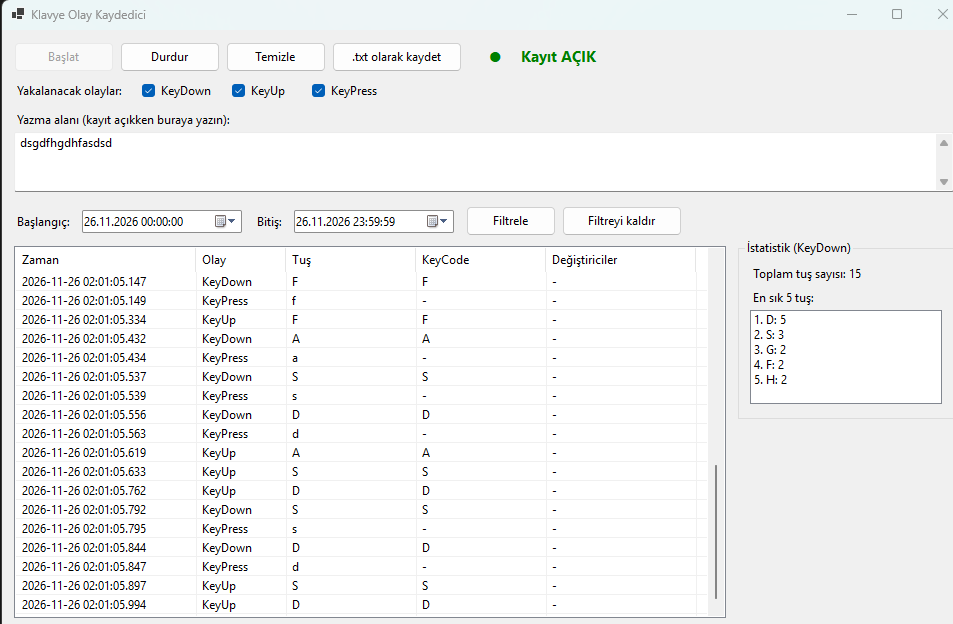
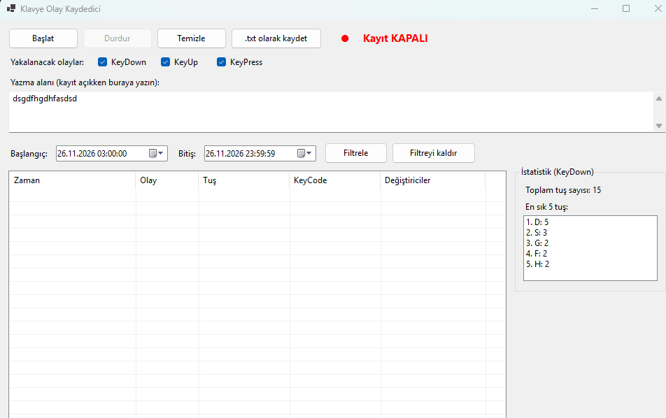

# YMH219-KeyEventLogger (Klavye Olay Kaydedici)

Yalnızca kendi penceresi odaktayken basılan tuşların `KeyDown`, `KeyUp` ve `KeyPress` olaylarını zamanıyla listeleyen, istenirse `.txt` dosyasına kaydeden C# Windows Forms uygulaması. YMH 219 Nesne Tabanlı Programlama dersi ek uygulama ödevidir.

## Kullanılan teknolojiler

- C# / .NET 10 (`net10.0-windows`), Windows Forms
- `System.IO` (`StreamWriter`) ve LINQ, ikisi de .NET ile gelir
- Harici NuGet paketi kullanılmamıştır

## Kurulum ve çalıştırma

Gereksinim: .NET 10 SDK; tasarımcı için Visual Studio 2026 veya dotnet run

```
git clone https://github.com/mah0cb/YMH219-KeyEventLogger.git
cd YMH219-KeyEventLogger
```

**dotnet run ile:**

```
dotnet run --project KeyEventLogger
```

**Visual Studio ile:** `YMH219-KeyEventLogger.sln` dosyasını açın ve F5'e basın.

## Temel özellikler

- Basılan tuşun zamanı (milisaniyeli), olay tipi, tuş adı, KeyCode ve Ctrl/Shift/Alt bilgisinin listelenmesi
- Başlat / Durdur / Temizle butonları
- Kayıt durumu göstergesi: yeşil nokta + "Kayıt AÇIK", kırmızı nokta + "Kayıt KAPALI"
- Hangi olay tiplerinin yakalanacağının CheckBox'larla seçilmesi
- Kayıtları `SaveFileDialog` + `StreamWriter` ile `.txt` dosyasına kaydetme (filtre açıksa yalnızca görünen kayıtlar)
- İstatistik: toplam tuş sayısı ve en sık basılan 5 tuş
- İki `DateTimePicker` ile tarih/saat aralığı filtresi

### Kayıt formatı

```
2026-11-24 14:05:33.120 | KeyDown | A | Shift
```

Zaman | olay tipi | tuş adı | değiştiriciler. Birden fazla değiştirici `Ctrl+Shift` gibi yazılır, hiç yoksa `-` yazılır.

### Odak yönetimi

Olaylar `KeyPreview = true` ile önce forma gelir. Başlat'a ve diğer kontrollere tıklandıktan sonra odak yazma alanına geri verilir. Yazma alanı Enter ve Tab tuşlarını kendisi aldığı için Space/Enter odaktaki butonu tetiklemez. Kayıt sırasında butonlar Tab sırasından çıkarılır, Alt ve F10'un pencere menüsünü açması engellenir.

### Hata yönetimi

Dosya yazma işlemi `try-catch` içindedir. İzin yoksa, dosya başka programda açıksa ya da yol geçersizse uygulama kapanmaz, Türkçe hata mesajı gösterilir. Kayıt yokken kaydetmeye çalışılırsa bilgi mesajı çıkar. Başlangıç zamanı bitişten sonraysa filtre uygulanmaz, uyarı verilir.

### Proje yapısı

| Dosya | Görev |
|---|---|
| `Models/KeyEventRecord.cs` | Tek bir klavye olayı kaydı ve metin formatı |
| `Models/OlayTipi.cs` | KeyDown / KeyUp / KeyPress |
| `Services/KeyEventLoggerService.cs` | Kayıt durumu, kayıt listesi, `RecordAdded` olayı |
| `Services/LogFileWriter.cs` | `.txt` dosyasına yazma |
| `Services/TusIstatistikleri.cs` | Toplam tuş ve en sık 5 tuş |
| `Services/KayitFiltresi.cs` | Tarih/saat aralığı filtresi |
| `Forms/AnaForm.cs` | Arayüz ve olay bağlama |

## Kapsam ve Güvenlik Sınırı

Bu uygulama bir eğitim aracıdır ve **yalnızca kendi penceresi odaktayken** klavye olaylarını görür. Bunun için Windows Forms'un `KeyPreview`, `KeyDown`, `KeyUp` ve `KeyPress` olayları kullanılır.

- **Global hook yoktur.** `SetWindowsHookEx`, `GetAsyncKeyState` veya başka bir Windows API çağrısı (P/Invoke) kullanılmaz. Başka bir pencereye geçildiğinde hiçbir olay kaydedilmez.
- **Gizli veya arka plan çalışma yoktur.** Uygulama normal, görünür bir pencere olarak çalışır; pencere kapanınca tamamen kapanır. Kayıt durumu her an ekranda gösterilir.
- **Başlangıçta otomatik çalışma yoktur.** Kayıt defteri, başlangıç klasörü veya zamanlanmış görev ayarı yapılmaz. Uygulama açıldığında kayıt KAPALI başlar.
- **Ağa gönderme yoktur.** Uygulamada hiçbir ağ bağlantısı yoktur.
- **Başka uygulamadan veri toplanmaz.**
- Kayıtlar yalnızca bellekte tutulur. Dosyaya yalnızca kullanıcı "Kaydet" deyip konumu kendisi seçerse yazılır, otomatik kayıt dosyası oluşturulmaz.

## Ekran görüntüleri

**Kayıt açık: olay listesi ve istatistik**



**Kayıt kapalı, tarih/saat filtresi uygulanmış**



## Bilinen sınırlamalar / geliştirme notları

- Tuş basılı tutulduğunda Windows'un ürettiği tekrarlı `KeyDown` olayları da kaydedilir ve istatistiğe girer.
- İstatistik yalnızca `KeyDown` olaylarından hesaplanır; KeyDown kutusu kapalıyken artmaz. Filtreden etkilenmez, tüm kayıtları kapsar.
- `KeyPress` olayında KeyCode bulunmaz, `-` gösterilir. AltGr ile yazılan karakterler Windows tarafından Ctrl+Alt olarak bildirilir.
- Print Screen gibi bazı tuşları Windows kendisi işlediği için bu tuşların her olayı uygulamaya ulaşmayabilir.
- İstatistik her yeni kayıtta tüm liste üzerinden yeniden hesaplanır; on binlerce kayıtta yavaşlarsa sayaç tabanlı hesaplamaya geçilebilir.
- Kayıtlar uygulama kapanınca silinir; kalıcı olması için `.txt` olarak kaydedilmelidir.

## Öğrenci

Mahmut Başcı, 205542016
